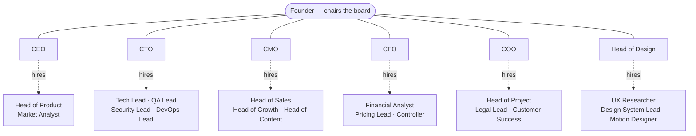
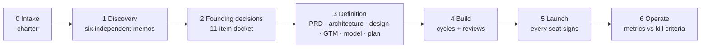

# Executive Board

**Six executive agents that take a product from idea to launch — and hire their own teams.**

One skill you assign to every agent. Each seat — CEO, CTO, CMO, CFO, COO, Head of Design — gets
decision rights, a playbook, and a curated stack of the best open-source skills for its job.
Any seat can create a sub-agent (a Head of Sales, a Head of Project, a QA Lead), choose its
skills, and train it for the project. You stay the founder: you chair the board and own every
irreversible call.



## Why this exists

Every new product needs the same handful of decisions made well — who it is for, what to
build first, on what stack, at what price, how it should feel, how it reaches people — and
then needs them carried out without drifting. Existing agent packs do half of it: the
"C-suite" packs advise, the engineering workflows build. This skill does both, and adds what
neither has:

- **Explicit decision rights.** Each decision has one owning seat. Others are consulted, not
  polled, and the founder approves anything that cannot be undone.
- **Independent positions before debate.** Seats write their view before seeing anyone
  else's, because agents shown an opinion tend to agree with it.
- **Files as memory.** Charter, status, org chart and decision records live in `board/`, so
  an agent that starts cold knows where the project stands.
- **The best skill for each job, already chosen.** A registry of third-party skills per
  seat, with exact install commands, checked against each repository.
- **Sub-agents that are actually trained.** A parent seat writes the charter — context,
  procedure, standards — and the tooling refuses to deploy an agent whose charter is empty.

## Install

**Claude Code — as a plugin** (the skill plus six ready-made executive subagents):

```text
/plugin marketplace add yeubridev/executive-board-skill
/plugin install executive-board@executive-board
```

**Any agent — with the skills CLI** (Claude Code, Codex, Cursor, and others):

```bash
npx skills add yeubridev/executive-board-skill
```

**Claude apps or anything else:** copy the `skills/executive-board/` folder into your agent's
skills location, or upload it as a skill. It is a standard Agent Skill with no dependencies
beyond Python for the optional helper script.

## Quick start

Start a new project and say what you want to build:

```text
I want to build <idea>. Use executive-board to run the kickoff.
```

The board interviews you, writes a one-page charter, has each seat study the idea from its
own angle, takes the founding decisions in order, and comes back with the few that need your
approval. From there:

| You say | What happens |
|---|---|
| `Run the kickoff in sprint mode` | One sitting: short charter, every seat's view, decisions logged, build plan |
| `Ask the board: should we do X or Y?` | Framing → independent positions → one round of challenge → a recorded decision |
| `As CTO, plan the architecture` | That seat works from its playbook and its skill stack |
| `CMO, hire a Head of Sales` | A charter written for this project, skills assigned, calibration task, ready to deploy |
| `Show the CTO stack` / `Install the design stack` | The curated skills for that seat and the exact commands |
| `Where are we?` | Phase, open gates, what is waiting on you |

## How it works



- **Seats.** Each has a role file: mandate, decision rights, deliverables per phase, the
  judgment calls that matter in that job, and its skill stack.
- **Depth.** `sprint` for a prototype, `standard` for a real product, `deep` when it is
  funded, regulated or hard to reverse. Ceremony matches the stakes.
- **The boardroom.** A `board/` folder in your project: `CHARTER.md`, `STATUS.md`, `ORG.md`,
  `DECISIONS.md`, decision records, and one folder per seat.
- **Decisions.** Two-way doors are decided by their owner and logged in a line. One-way doors
  get a full board meeting, a written record with the dissent, and your approval.
- **Hiring.** Decide whether a sub-agent is worth its cost → write its mission → assign three
  to six skills → write what it needs to know → calibrate on a real task → deploy → review at
  every gate → retire.

## The stacks

Each seat's core skills, from the registry in
[`assets/registry.json`](skills/executive-board/assets/registry.json). The full list, with
recommended and optional tiers, licences and sources, is in **[STACKS.md](STACKS.md)**.

<!-- CORE:START -->
| Seat | Core stack |
|---|---|
| **CEO** | [phuryn/pm-skills](https://github.com/phuryn/pm-skills) — `product-strategy`, `product-vision`, `startup-canvas` …<br/>[alirezarezvani/claude-skills](https://github.com/alirezarezvani/claude-skills) — `ceo-advisor`, `scenario-war-room`, `competitive-intel` …<br/>[anthropics/knowledge-work-plugins](https://github.com/anthropics/knowledge-work-plugins) — `write-spec`, `competitive-brief`, `metrics-review` … |
| **CTO** | [obra/superpowers](https://github.com/obra/superpowers) — `brainstorming`, `writing-plans`, `test-driven-development` …<br/>[mattpocock/skills](https://github.com/mattpocock/skills) — `setup-matt-pocock-skills`, `grill-with-docs`, `to-spec` …<br/>[DietrichGebert/ponytail](https://github.com/DietrichGebert/ponytail) — `ponytail`, `ponytail-review`, `ponytail-audit` …<br/>[anthropics/claude-plugins-official](https://github.com/anthropics/claude-plugins-official) — `code-review`, `security-guidance` |
| **CMO** | [coreyhaines31/marketingskills](https://github.com/coreyhaines31/marketingskills) — `product-marketing`, `customer-research`, `competitor-profiling` …<br/>[blader/humanizer](https://github.com/blader/humanizer) — `humanizer` |
| **CFO** | [alirezarezvani/claude-skills](https://github.com/alirezarezvani/claude-skills) — `cfo-advisor`, `financial-analyst`, `saas-metrics-coach`<br/>[anthropics/skills](https://github.com/anthropics/skills) — `xlsx`<br/>[phuryn/pm-skills](https://github.com/phuryn/pm-skills) — `pricing-strategy`, `monetization-strategy`, `business-model` |
| **COO** | [anthropics/knowledge-work-plugins](https://github.com/anthropics/knowledge-work-plugins) — `process-doc`, `runbook`, `status-report` …<br/>[alirezarezvani/claude-skills](https://github.com/alirezarezvani/claude-skills) — `coo-advisor`, `company-os`, `change-management` …<br/>[phuryn/pm-skills](https://github.com/phuryn/pm-skills) — `outcome-roadmap`, `brainstorm-okrs`, `sprint-plan` … |
| **Head of Design** | [pbakaus/impeccable](https://github.com/pbakaus/impeccable) — `impeccable`<br/>[anthropics/skills](https://github.com/anthropics/skills) — `frontend-design`, `canvas-design`, `theme-factory`<br/>[nextlevelbuilder/ui-ux-pro-max-skill](https://github.com/nextlevelbuilder/ui-ux-pro-max-skill) — `ui-ux-pro-max`<br/>[emilkowalski/skills](https://github.com/emilkowalski/skills) — `emil-design-eng`, `animate`, `review-animations` …<br/>[vercel-labs/agent-skills](https://github.com/vercel-labs/agent-skills) — `web-design-guidelines` |
<!-- CORE:END -->

Curated is not audited. These are other people's projects, they change, and a skill runs with
your agent's permissions. The skill ships a [vetting checklist](skills/executive-board/references/skill-vetting.md),
and its installer prints commands instead of running them unless you pass `--run`.

## Sub-agents

Ready-made archetypes, each with a mission, deliverables, a skill stack and a calibration task.
Seats can also hire from scratch.

<!-- ARCHETYPES:START -->
| Reports to | Archetype | Mission |
|---|---|---|
| CEO | Head of Product (`head-of-product`) | Turn the board's decisions into a PRD and a backlog an engineer can build from and a tester can test from. |
| CEO | Market Analyst (`market-analyst`) | Keep the board's picture of the market and the competition true and sourced. |
| CTO | Tech Lead (`tech-lead`) | Build the plan cycle by cycle: tested, reviewed, working code for each story. |
| CTO | QA Lead (`qa-lead`) | Try to break every story before it is called done, as someone who did not write it. |
| CTO | Security Lead (`security-lead`) | Find the ways this product can be attacked or can leak data before someone else does. |
| CTO | DevOps Lead (`devops-lead`) | Make shipping boring: CI, environments, observability, and a rollback that has been tried. |
| CMO | Head of Sales (`head-of-sales`) | Turn the positioning into a pipeline: find the right accounts, start conversations, and learn why deals are won or lost. |
| CMO | Head of Growth (`head-of-growth`) | Find what moves acquisition and activation, by running small measured experiments. |
| CMO | Head of Content (`head-of-content`) | Earn attention with content people search for and want to read, in the brand's voice. |
| CFO | Financial Analyst (`financial-analyst`) | Build and maintain the financial model, and report actuals against it. |
| CFO | Pricing Lead (`pricing-lead`) | Find the price and packaging that customers accept and the model needs. |
| CFO | Controller (`controller`) | Keep the books true once money moves: cash, invoices, reconciliation, month-end. |
| COO | Head of Project (`head-of-project`) | Keep the plan true: who does what by when, what depends on what, and which date is at risk first. |
| COO | Legal and Compliance Lead (`legal-counsel`) | Spot legal and compliance exposure early and prepare drafts for a qualified lawyer to review. Never the final word on a legal question. |
| COO | Head of Customer Success (`head-of-customer-success`) | Make sure customers get an answer and get value, and bring what they say back to the board. |
| Head of Design | UX Researcher (`ux-researcher`) | Replace the board's assumptions about users with evidence. |
| Head of Design | Design System Lead (`design-system-lead`) | Build and guard the design system: tokens and components that make every screen consistent by default. |
| Head of Design | Motion Designer (`motion-designer`) | Give the product motion that explains and delights without slowing anyone down. |
<!-- ARCHETYPES:END -->

```bash
python skills/executive-board/scripts/board.py hire --archetype head-of-sales   # charter + org row
python skills/executive-board/scripts/board.py install head-of-sales            # its skills (prints; --run executes)
python skills/executive-board/scripts/board.py deploy head-of-sales             # → .claude/agents/head-of-sales.md
```

Headcount is capped (three reports per seat, two levels deep, both configurable in the
charter), because every extra agent adds coordination cost faster than it adds output.

## Assigning it to your own agents

The skill resolves its seat from the agent it is loaded into:

- An agent whose instructions say "you are the CTO" takes the CTO seat and reads the CTO playbook.
- An agent with no role acts as Chief of Staff: it facilitates, convenes the seats, and keeps
  the files true.
- On platforms where each executive is a long-lived agent, assign this one skill to all six
  and state each agent's seat in its own instructions. They coordinate through `board/`.

[platforms.md](skills/executive-board/references/platforms.md) covers Claude Code, the Agent
SDK, multi-agent platforms, single chats and other coding agents.

## Safety

- Nothing is installed or executed by the helper script unless you pass `--run`.
- Spending money, publishing or sending anything, production deploys, deleting data and
  accepting terms always go to the founder.
- The skill pre-approves reading files under `~/.claude/skills/` and `~/.claude/plugins/` so
  seats can open their own playbooks without a prompt. It requests no other permission.
- Legal and financial output is a draft for a qualified professional, and the seats are told
  to say so.

## Repository layout

```text
skills/executive-board/      the skill (this folder is what gets installed)
  SKILL.md                   entry point: seat, boardroom, routing, ground rules
  references/roles/          one playbook per seat
  references/                kickoff, board meetings, hiring, vetting, platforms, catalog
  assets/registry.json       curated skills per seat and archetype — the source of truth
  assets/templates/          charter, status, org, decision record, agent charter…
  assets/agents/             the six seat definitions
  scripts/board.py           init · stack · install · catalog · hire · deploy · retire
agents/                      plugin copies of the seat definitions (generated)
tools/build.py               regenerates everything derived from the registry, and validates
tests/                       unit tests for board.py
```

**Changing a stack:** edit `assets/registry.json`, run `python tools/build.py`, commit. CI runs
`python tools/build.py --check` and the tests.

## Credits

This skill stands on other people's work. Every repository it recommends is listed with its
licence in [STACKS.md](STACKS.md); none of their content is copied here. Design patterns were
informed by obra/superpowers (dispatch and review discipline), alirezarezvani/claude-skills
(isolated board contributions), paperclipai/paperclip (hiring with an approval gate) and
garrytan/gstack (roles as working modes).

## Licence

[MIT](LICENSE)

---

## En français

**Six agents dirigeants qui mènent un produit de l'idée au lancement, et qui recrutent leurs propres équipes.**

Un seul skill à assigner à chacun de vos agents. Chaque siège (CEO, CTO, CMO, CFO, COO, Head
of Design) reçoit ses droits de décision, sa méthode de travail et une sélection des meilleurs
skills open source pour son métier. Chaque dirigeant peut créer un sous-agent (Head of Sales,
Head of Project, QA Lead…), lui assigner ses skills et le former au projet. Vous restez le
fondateur : vous présidez le board et validez tout ce qui est irréversible.

**Installer**

```text
/plugin marketplace add yeubridev/executive-board-skill
/plugin install executive-board@executive-board
```

ou, pour n'importe quel agent : `npx skills add yeubridev/executive-board-skill`

**Démarrer un projet**

```text
Je veux construire <idée>. Utilise executive-board pour faire le kickoff.
```

Le board vous interroge, rédige une charte d'une page, fait analyser l'idée par chaque siège
indépendamment, prend les décisions fondatrices dans l'ordre et revient vers vous avec les
quelques points à valider. Ensuite : `Demande au board : X ou Y ?`, `CMO, recrute un Head of
Sales`, `Montre la stack du CTO`, `Où en est-on ?`.

Les livrables peuvent être rédigés en français : précisez-le dans la charte (« Language of
deliverables »). Le détail des stacks par rôle est dans [STACKS.md](STACKS.md).
